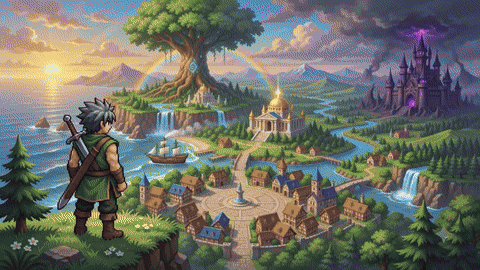
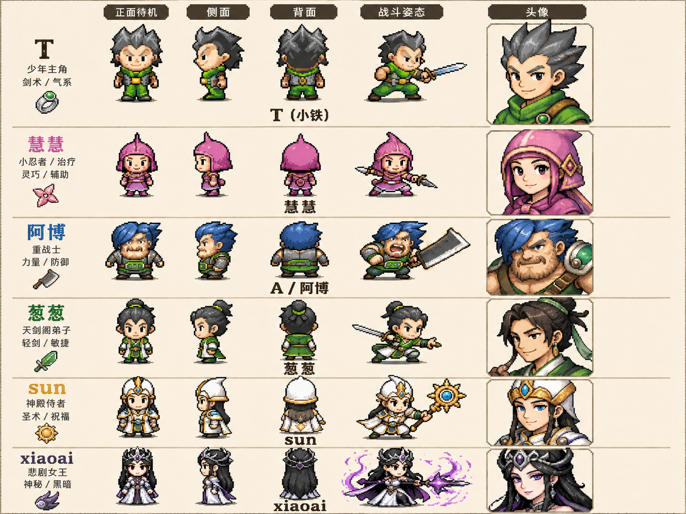
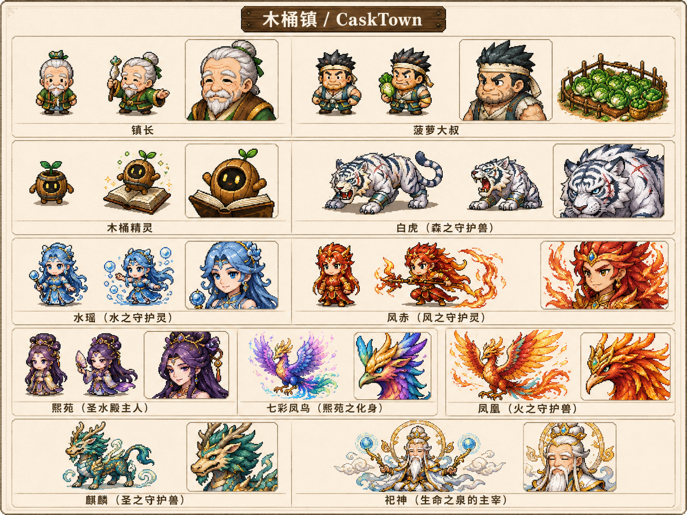
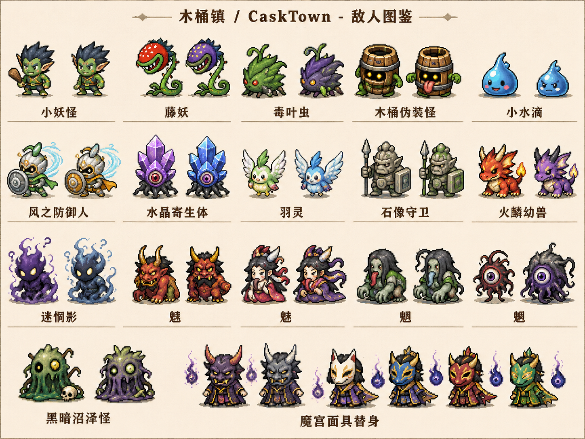
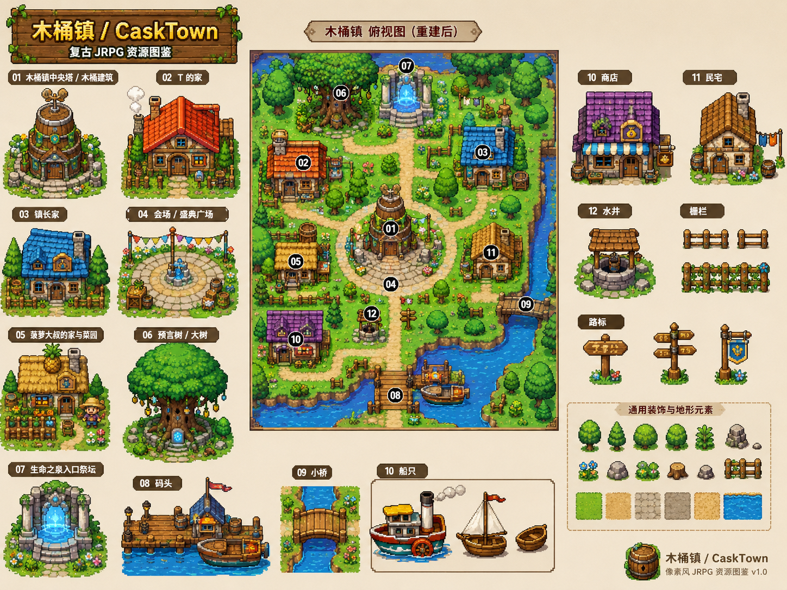
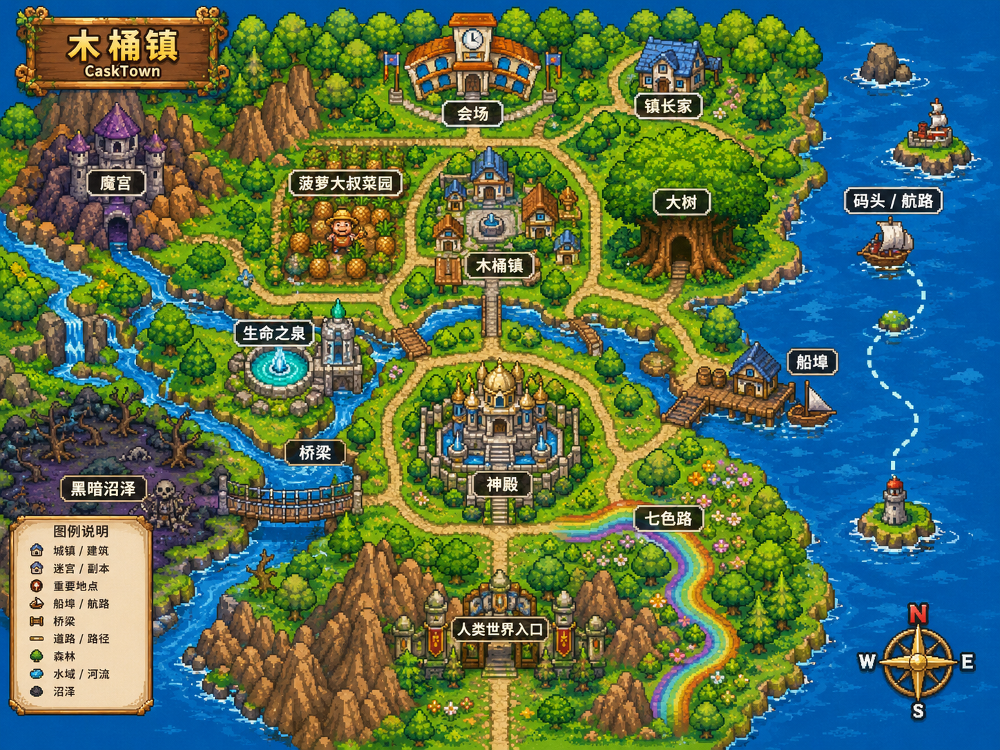
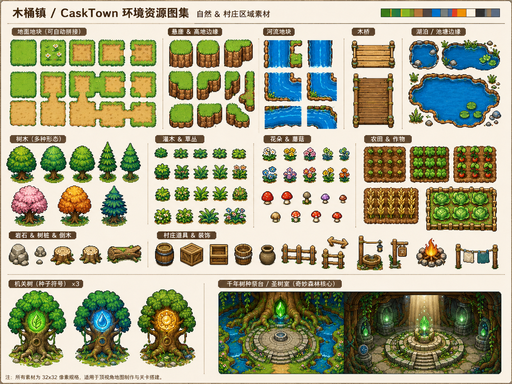
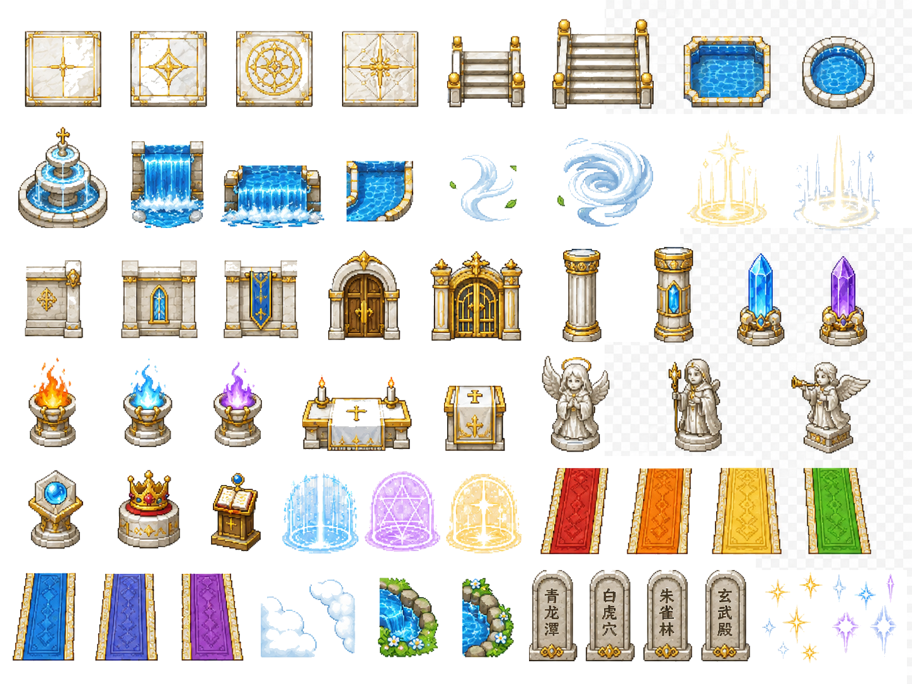
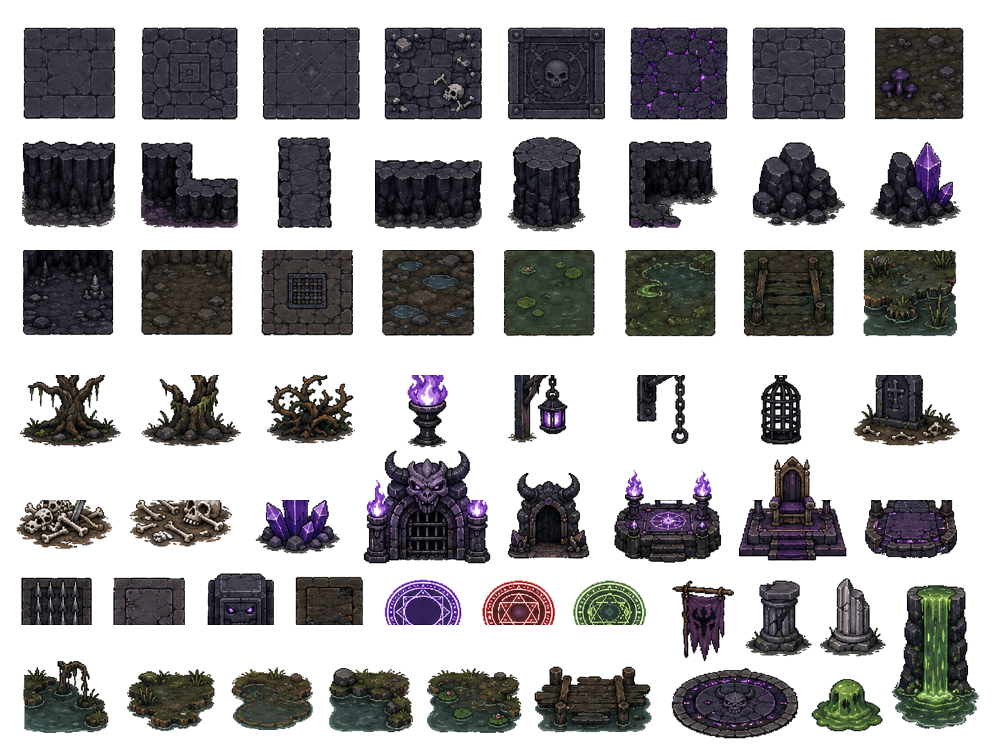

# CaskTown / 木桶镇

**English** · [简体中文](README.md)

CaskTown (木桶镇) is a browser-based, top-down story-driven JRPG. You play as a boy named T, who sets out from the blighted town of CaskTown with companions Huihui, Abo, Congcong and Sun to recover three sacred relics and rebuild the town, travel to the Spring of Life to uncover why xiaoai fell, and finally face the darkness at the bottom of the human heart — a fairy-tale surface wrapped around a story about mercy.

The project runs on Phaser 4.1.0, TypeScript, Vite 8 and Bun, with runtime assets served from Vite's `assets` public directory.

## Play it online

- GitHub Pages: [https://cyber-tao.github.io/casktown](https://cyber-tao.github.io/casktown)
- Vercel: [https://casktown.vercel.app](https://casktown.vercel.app)
- Cloudflare: [https://casktown.pages.dev](https://casktown.pages.dev)

All three serve the full game directly in the browser — nothing to install.

## A look at the game

This 10-second muted loop doubles as the animated background of the game's title screen:

<a href="assets/trailer.mp4">
  
</a>

[Watch the full-quality MP4](assets/trailer.mp4)

## Origin

CaskTown began as a game idea that Hoker.JT and a group of friends came up with while hanging out on the "Hoker" forum as students. The characters are those friends: their nicknames, personalities and inside jokes became the original cast and the tone of the adventure.

The very first version of the game was not built by Hoker.JT — other forum members wrote it in QUICKBASIC under DOS. This repository is the web remake by Hoker.JT, so that a student-era project can be shared, opened and played easily, and so that the old ideas can be told again with a fuller story, more systems and real art.

## What the game offers

CaskTown follows the exploration, dialogue, combat and growth loop of a classic JRPG, paced for short browser sessions:

- Story exploration — top-down movement, examining objects, NPC dialogue and event triggers.
- Turn-based combat — character skills, resource management, enemy mechanics, and boss fights that move the plot forward.
- Town rebuilding — main-story relics and side-quest resources bring CaskTown back from ruin.
- Menus — the Book of Prophecy (main quests and progress), party, inventory, skills, codex (monsters / items / story and branch records), save-load, and settings.

## World and setting

CaskTown is the heart of the story. After the festival day, disaster strikes the town, and T and his companions set out to find the relics and restore their home. The world opens on a bright fairy-tale village and gradually connects to the Wondrous Forest, the Sacred Water Hall, the Seven-Colour Road, the Temple, the Spring of Life and the Demon Palace.

The surface of the story keeps a light, cute tone shaped by the old forum friendships; underneath it deals with a destroyed home, the sacrifice of guardian beasts, the fall of a herald, and the darkness in people's hearts. Rebuilding the town, understanding xiaoai's past, breaking the seals of the Spring of Life, and whether you reach the true ending all depend on your choices in story and combat.

## Quick start

You need [Bun](https://bun.sh) — the repo commits `bun.lock` and CI builds with Bun.

```bash
bun install
```

```bash
bun run dev
```

The dev server runs at `http://localhost:5173` and opens a browser; the sprite-configuration editor is served at `/editor.html`.

## Commands

| Command | What it does |
| --- | --- |
| `bun run dev` | Start the Vite dev server (port 5173) |
| `bun test` | Run the unit and integration suite (39 files / 419 tests) |
| `bun run typecheck` | Strict TypeScript check across `src`, `tests` and `scripts` |
| `bun run build` | Type-check and build to `dist` (game + editor entries) |
| `bun run preview` | Preview the production build |
| `bun run sprites:refresh` | Generate UI/icons from design sources, repair atlases, slice them into `assets/sprites` |
| `bun run sprites:repair` | Atlas repair only: remove connected backgrounds and edge bleed per frame |
| `bun run voices:sync` | Sync voice-line definitions into `voice_lines.json` from the dialogue data |
| `bun run voices:generate` | Generate character voice audio into `assets/audio/voice` (requires external `mmx` and `ffmpeg`) |

The `sprites:*` scripts and `voices:generate` rewrite asset files in the repo; you do not need them to play or to contribute code.

## Tech stack

| Area | What is used |
| --- | --- |
| Runtime and package manager | Bun |
| Game engine | Phaser 4.1.0 (Canvas renderer, 1920x1080 logical resolution, `pixelArt`) |
| Language | TypeScript 6 (strict, including `noUncheckedIndexedAccess`) |
| Build tool | Vite 8 (two entries: `index.html` for the game, `editor.html` for the editor) |
| Testing | Bun's built-in test runner (39 test files) |
| Saves | Browser LocalStorage (3 manual slots + quick save, JSON export/import) |

## Controls

- Keyboard: arrow keys to move, `Enter` to confirm, `Esc` to cancel or open the menu. An alternative `WASD` + `Space` layout is available, and bindings can be reassigned in Settings.
- Gamepad: standard controller D-pad, confirm, cancel and start.
- Touch: on-screen D-pad and action buttons on maps; portrait phones are asked to rotate to landscape.
- Hotkeys: `F5` quick save, `F9` quick load (while exploring a map).

## Project layout

```text
index.html        Game entry (startup and loading splash live in the HTML shell)
editor.html       Configuration editor entry
src/
  main.ts         Boot entry (registers the F5/F9 hotkeys)
  game.ts         Phaser game configuration
  core/           Global managers and systems (GameData / EventBus / SaveManager, ...)
  data/           Characters, quests, maps, enemies, items, skills, dialogues, types
  scenes/         Phaser scenes and UI overlays
  utils/          Shared constants, battle rules, touch, voice helpers
  editor/         Configuration editor front end
  qa/             Automated mainline/ending validator (`?qa=mainline` / `?qa=normal`)
scripts/          Development scripts for sprite slicing, icon generation, voice sync
tests/            Bun test files
assets/           Vite public directory, served at runtime
  audio/          BGM, SFX and character voice
  sprites/        Characters, scenes, monsters, NPCs, world objects and UI images
img/
  desiges/        Art design sheets and previews (build-time reference, some UI assets are generated from it)
  sprites/        Sliceable sprite sheets, JSON metadata and the pack manifest
doc/              Game design document and full story script
```

JSON under [img/sprites](img/sprites) uses a TexturePacker-like `frames + meta` structure so atlases can be sliced by pixel coordinates; at runtime `AssetLoader` loads the sliced results under [assets/sprites](assets/sprites) on demand, while `BootScene` preloads only the title/loading backgrounds and audio.

## Art design sheets

[img/desiges](img/desiges) holds the project's art sheets and combined previews, used to keep characters, enemies, maps and environments on-model. It currently covers the hero and party, NPCs and guardians, enemy designs, an overhead map of CaskTown, the world map, and tileset references for natural, temple and dark-fantasy areas.

These images are design references from the development and remake process; runtime code never loads them directly. Some of them (title and loading backgrounds, a few UI panels and item icons) are processed into runtime assets by build scripts and written to [assets/sprites](assets/sprites). The sliced resources and their metadata live in [img/sprites](img/sprites).

### Characters, NPCs and enemies

| Heroes and party | NPCs and guardians | Enemy designs |
| --- | --- | --- |
|  |  |  |

### Maps and environments

| CaskTown overhead map | World map |
| --- | --- |
|  |  |

| Nature tiles | Temple tiles | Dark fantasy tiles |
| --- | --- | --- |
|  |  |  |

## Art asset pipeline

1. Create or update the atlas PNGs and their JSON metadata in [img/sprites](img/sprites), based on the character, enemy, map and environment sheets in [img/desiges](img/desiges).
2. Run `bun run sprites:refresh`. It first generates UI panels and item icons from the design sources, then reads [img/sprites/pack_manifest.json](img/sprites/pack_manifest.json) and repairs and slices every atlas by the frame coordinates in the JSON.
3. The sliced output is written to [assets/sprites](assets/sprites), where the runtime `AssetLoader` picks it up on demand.

## Further reading

- [Game design document](doc/CaskTown_Web_JRPG_GDD_v2.md): positioning, systems, map structure, combat pacing and UI goals (in Chinese).
- [Full story and branch script](doc/CaskTown_Full_Script_Branches_BattlePoints.md): complete script, character codes, branch variables, true-ending conditions and battle trigger points (in Chinese).
- [AGENTS.md](AGENTS.md): architecture boundaries, commands and common modification paths — required reading for human and AI contributors (in Chinese).

## Development notes

- The entry point is [src/main.ts](src/main.ts); the Phaser 4 configuration is in [src/game.ts](src/game.ts).
- Startup assets are preloaded in [src/scenes/BootScene.ts](src/scenes/BootScene.ts); map, battle and menu textures are loaded on demand by [src/core/AssetLoader.ts](src/core/AssetLoader.ts).
- Global game state lives in [src/core/GameData.ts](src/core/GameData.ts); scenes talk to each other through [src/core/EventBus.ts](src/core/EventBus.ts).
- Put new constants in [src/utils/constants.ts](src/utils/constants.ts) instead of hard-coding numbers.
- Before committing, run `bun run typecheck` and `bun test`.

## License

Released under the [MIT License](LICENSE). You are free to use, modify and redistribute this project, provided the copyright and permission notice are kept.
